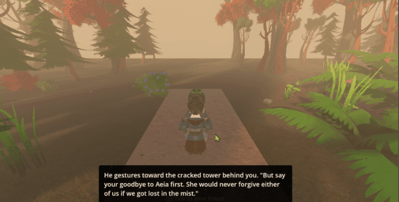

# 3D Cinematic RPG (working title)



A story-first medieval fantasy RPG built in **Godot 4.6 / GDScript**: handcrafted, interconnected zones that feel open through density of discovery rather than acreage, with cinematic presentation.

You play a young knight on the last ordinary afternoon in his home village: friends, family, the girl he loves, his best friend at his side. The two walk down to the shore, where boats emerge from the mist. Raiders. The village is lost, and the knight survives with one purpose: get strong enough to take revenge. Full premise and design pillars are in [GAME_PITCH.md](GAME_PITCH.md).

## Status

**Milestone 1 — Vertical slice: complete.** Playable end to end, village → guard tower → shore:
- One dense zone with environmental-storytelling setups and an optional secret
- An NPC conversation with a real branching choice whose consequence pays off later
- A micro-quest ("The Last Afternoon"): hook → choice → consequence
- A scripted cinematic: camera push over the misted water as the raider boats emerge (Phantom Camera + AnimationPlayer + Dialogic), skippable and fire-once
- Save / quit / load preserving story flags, quest state and player position
- Playtested by hand on top of the automated suite

**Milestone 2 — Zone 1 art pass: in progress.** Graybox replaced with rigged, animated characters, real buildings, a forest surround and textured ground; props pass is next. See [ROADMAP.md](ROADMAP.md).

## Architecture

Gameplay is built from small reusable components, and story state lives in one place so that every system stays save-safe by construction.

**Components** (`scripts/components/`)
| Script | Role |
|---|---|
| `interactable.gd` | The single interaction primitive (`Area3D`): announces itself to the HUD via EventBus when the player is in range, emits `interacted` on use |
| `npc_interactable.gd` | Extends Interactable; starts a Dialogic conversation timeline |
| `flavor_interactable.gd` | Extends Interactable; examinable prop with environmental-storytelling text, optionally sets a flag (e.g. the hidden secret) |
| `zone_exit.gd` | Extends Interactable; asks SceneDirector to change zones, optionally gated on a story flag |
| `cutscene.gd` | Reusable cutscene controller: an AnimationPlayer conducts camera cuts/pushes and dialogue cues; gated by a completion flag so it plays once, survives save/load, and can be skipped |
| `animated_character.gd`, `idle_animator.gd` | Drive imported character rigs from a shared animation library so NPCs never sit in bind pose |

**Autoloads** (`scripts/autoload/`)
- `GameState` — single source of truth for namespaced story flags (`act1/found_carved_heart`) and quest stages
- `EventBus` — global signal relay; systems never hold cross-scene node references
- `SaveManager` — serializes GameState + zone + player transform to JSON
- `SceneDirector` — owns zone transitions (fade → swap → spawn point → fade)
- `QuestManager` — advances `QuestResource` (.tres) stages by reading flags, never world state

**Narrative is data, not code:** dialogue lives in Dialogic timelines (`dialogue/`), quests in `.tres` resources (`data/`). Dialogue conditions read GameState directly; choices write back through a small bridge (`scripts/dialogue/dialogic_bridge.gd`).

The player controller (`scripts/characters/player.gd`) picks idle/walk/run from actual horizontal velocity rather than input, so animation stays correct through acceleration ramps and cutscenes.

## Tests

70 GUT tests cover flag storage, save/load round-trips (including mid-quest reload and fire-once cutscenes), quest stage transitions, the dialogue bridge, zone transitions, and level geometry (interaction triggers line up with the art they belong to; the player can't escape the zone bounds).

```powershell
godot --headless --path . --import    # first run only
godot --headless --path . -s res://addons/gut/gut_cmdln.gd -gdir=res://tests -ginclude_subdirs -gexit
```

## Running it

Requires **Godot 4.6.3** (Forward+ renderer, Vulkan) and **Git LFS** (art assets under `assets/` are LFS-tracked):

```
git lfs install
git clone https://github.com/travisjones-dev/3d-cinematic-game.git
```

Open `project.godot` in Godot and press F5. Windows build instructions are in [docs/BUILD.md](docs/BUILD.md).

## Built with

- [Godot 4.6](https://godotengine.org/)
- [Dialogic 2](https://github.com/dialogic-godot/dialogic): dialogue and timelines
- [Phantom Camera](https://github.com/ramokz/phantom-camera): cinematic cameras
- [GUT](https://github.com/bitwes/Gut): unit testing

Art is CC0, mostly by Quaternius and Poly Haven. Full list in [CREDITS.md](CREDITS.md).
